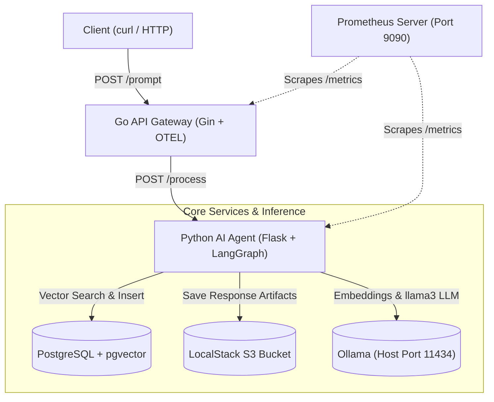

# Cloud-Native AI Sandbox

[](https://go.dev/)
[](https://www.python.org/)
[](https://kind.sigs.k8s.io/)
[](https://langchain-ai.github.io/langgraph/)
[](https://opentelemetry.io/)
[](https://prometheus.io/)
[](https://opentofu.org/)
[](https://opensource.org/licenses/MIT)

A local, zero-cost, cloud-native platform demonstrating microservices, Retrieval-Augmented Generation (RAG) with **LangGraph** and **pgvector**, OpenTelemetry tracing, **Prometheus** metrics, **LocalStack** simulated AWS S3 storage, and local LLM orchestration.

---

## 🏗️ Architecture Overview



---

## 🧩 Microservices & Components

### 1. Go API Gateway (`app/main.go`)
* Built with **Go 1.26** and **Gin**.
* Emits **OpenTelemetry** trace spans to `stdout` (`stdouttrace`) and exposes **Prometheus** HTTP metrics (`http_requests_total`, `http_request_duration_seconds`).
* Exposes `POST /prompt`, `GET /health`, and `GET /metrics` on port `8080`.

### 2. Python LangGraph AI Agent (`agent/agent.py`)
* Built with **Flask** and **LangGraph**.
* Executes a stateful 3-node RAG graph:
  1. **`embed_and_retrieve`**: Embeds incoming queries via Ollama (`llama3`) and runs cosine-distance similarity search (`<=>`) against PostgreSQL `pgvector`.
  2. **`generate`**: Augments the prompt with retrieved context and runs `llama3` inference on Ollama.
  3. **`persist`**: Uploads generated responses to LocalStack S3 (`ai-agent-storage`) and stores 4096-dimensional embeddings in `pgvector`.
* Exposes node-level Prometheus latency histograms (`agent_graph_node_latency_seconds`) and request counters (`agent_requests_total`).

### 3. Infrastructure & Observability
* **PostgreSQL (`pgvector/pgvector:pg16`)**: In-cluster vector similarity database reading credentials from the `postgres-credentials` Kubernetes Secret.
* **Prometheus (`prom/prometheus:v2.51.0`)**: In-cluster metrics aggregator scraping both services every 5 seconds.
* **LocalStack (`3.8.1`)**: Local AWS cloud emulator exposing simulated S3 APIs on host port `4566`.
* **Ollama**: Host-level local inference engine serving `llama3` on port `11434`.
* **Kind (Kubernetes in Docker)**: Single-node local Kubernetes cluster (`ai-sandbox`).
* **OpenTofu / Terraform**: Declarative infrastructure configs provisioning the `ai-sandbox` namespace, LocalStack S3 bucket, and `postgres-credentials` Kubernetes Secret.

---

## 📁 Repository Structure

```text
├── agent/
│   ├── agent.py            # Flask microservice & LangGraph RAG workflow
│   ├── Dockerfile          # Python 3.11-slim container build definition
│   └── requirements.txt    # Python dependencies (LangGraph, pgvector, boto3)
├── app/
│   ├── main.go             # Go API Gateway with OTEL & Prometheus
│   ├── go.mod              # Go module definition
│   └── Dockerfile          # Multi-stage Go build definition
├── k8s/
│   ├── deploy.yaml         # Deployments & Services for Gateway and Agent
│   ├── postgres.yaml       # Deployment & Service for PostgreSQL + pgvector
│   └── prometheus.yaml     # ConfigMap, Deployment & Service for Prometheus
├── terraform/
│   ├── main.tf             # Terraform resources (Namespace, S3, Secrets)
│   └── providers.tf        # LocalStack AWS & Kubernetes provider configs
├── scripts/
│   └── run.sh              # Kind bootstrap, build/load, rollout & port-forwarding
├── kind-config.yaml        # Single-node Kind cluster configuration
├── LICENSE                 # MIT license
└── README.md
```

---

## 📋 Prerequisites

* **Linux / macOS** host system
* **Docker Engine** (v24.0+)
* **Kind** & **kubectl**
* **OpenTofu / Terraform** (optional if provisioning namespace/bucket/secret declaratively) & **AWS CLI** (for verifying S3 objects)
* **Ollama** with `llama3` pulled (`ollama pull llama3`) and reachable from containers:
  * On Linux, start Ollama bound to all interfaces (`OLLAMA_HOST=0.0.0.0:11434 ollama serve`) so pods inside Kind can reach it via the Docker bridge gateway.

---

## 🚀 Setup & Deployment

### 1. Launch LocalStack & Kind Cluster
```bash
docker rm -f localstack 2>/dev/null || true
docker run -d --name localstack -p 0.0.0.0:4566:4566 localstack/localstack:3.8.1

# Create the Kind cluster if it does not already exist
kind create cluster --name ai-sandbox --config kind-config.yaml
```

### 2. Provision Namespace, S3 Bucket & Secret (Terraform / OpenTofu)
```bash
cd terraform
tofu init   # or: terraform init
tofu apply  # creates ai-sandbox namespace, ai-agent-storage bucket, and postgres-credentials secret
cd ..
```

*(If you skip Terraform, create the bucket with `aws --endpoint-url=http://localhost:4566 s3 mb s3://ai-agent-storage` and `scripts/run.sh` will create the namespace and fallback `postgres-credentials` secret automatically.)*

### 3. Build & Deploy to Kubernetes
Run from the repository root:
```bash
chmod +x scripts/run.sh
./scripts/run.sh
```

`scripts/run.sh` builds and loads both container images into Kind, discovers the Kind bridge gateway IP on Linux (or `host.docker.internal` on macOS), deploys Postgres, Prometheus, Gateway, and Agent, and starts port-forwarding (`Ctrl-C` stops port-forwarding cleanly).

---

## 🧪 Verification & Testing

### 1. Seed Vector Database with Initial Prompt
```bash
curl -X POST http://localhost:8080/prompt \
  -H "Content-Type: application/json" \
  -d '{"prompt": "Explain what Kubernetes pods are in detail."}'
```
*(First query returns `"context_retrieved": false`.)*

### 2. Test LangGraph Vector RAG Context Retrieval
```bash
curl -X POST http://localhost:8080/prompt \
  -H "Content-Type: application/json" \
  -d '{"prompt": "How do containers inside the same pod communicate with each other?"}'
```
*(Follow-up query returns `"context_retrieved": true` as LangGraph matches prior context via `pgvector`.)*

### 3. Verify LocalStack S3 Storage
```bash
AWS_ACCESS_KEY_ID=mock_key AWS_SECRET_ACCESS_KEY=mock_secret AWS_DEFAULT_REGION=us-east-1 \
  aws --endpoint-url=http://localhost:4566 s3 ls s3://ai-agent-storage/
```

### 4. Inspect Vector Records in PostgreSQL
```bash
kubectl exec -it deployment/postgres-deployment -n ai-sandbox -- \
  psql -U postgres -d aisandbox -c "SELECT id, prompt, left(response, 40) as preview, created_at FROM embeddings_store;"
```

---

## 📊 Observability & Metrics

### Prometheus Dashboard
Open **[http://localhost:9090](http://localhost:9090)** in your browser to inspect live telemetry:

| Metric | Target | Description |
| :--- | :--- | :--- |
| `http_requests_total` | Go Gateway | Request counter labeled by path and HTTP status code |
| `http_request_duration_seconds` | Go Gateway | Latency histogram for HTTP requests |
| `agent_requests_total` | Python Agent | Total prompt requests handled |
| `agent_graph_node_latency_seconds` | Python Agent | Latency broken down per LangGraph node (`embed_and_retrieve`, `generate`, `persist`) |

---

## 📜 License

This project is licensed under the MIT License — see the [LICENSE](LICENSE) file for details.
